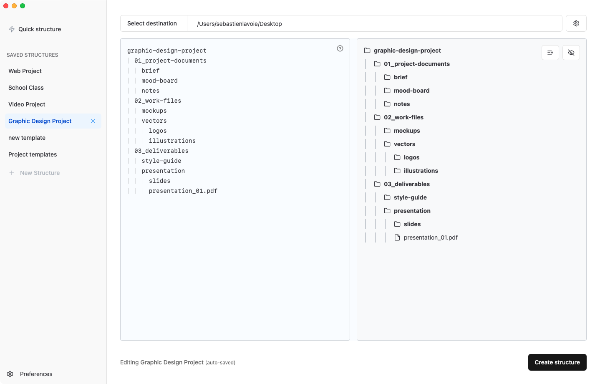

# File Architect

File Architect is a desktop application that allow users to create file and folder structures from plain text. Available on [filearchitect.com](https://filearchitect.com).



## Development

This repository contains the core functionality for File Architect. The app is built using:

- Tauri (Rust + TypeScript)
- React
- Vite
- shadcn/ui components

### Building from Source

1. Install dependencies:

```bash
pnpm install
```

2. Create a local env file:

```bash
cp .env.example .env
```

3. Run in development:

```bash
pnpm run tauri dev
```

to rebuild with filearchitect/core

```bash
pnpm run tauri:dev
```

### Windows Development Setup

On Windows (especially ARM64), additional setup is required due to native compilation dependencies:

#### Prerequisites

1. **Visual Studio Build Tools 2022** with:

   - "Desktop development with C++" workload
   - "C++ ARM64 build tools" component (for ARM64 Windows)

2. **LLVM** (includes clang) - Install via:

   ```bash
   winget install LLVM.LLVM
   ```

3. **Native bindings for Windows ARM64** - Required packages:
   ```bash
   pnpm add -D @tauri-apps/cli-win32-arm64-msvc@^2.9.6 @rollup/rollup-win32-arm64-msvc@^4.57.1
   ```

#### Running on Windows

Due to MSVC environment requirements, use the provided batch file:

```bash
npm run tauri:dev:msvc
```

Or directly:

```bash
.\tauri-dev.bat
```

This batch file will:

- Set up the MSVC environment for ARM64
- Add LLVM/clang to PATH (required for the `ring` crate)
- Configure compiler environment variables
- Build the monorepo and start the Tauri dev server

**Notes:**

- If you encounter "clang not found" errors, restart your terminal after installing LLVM to refresh the PATH, or the batch file will attempt to add it automatically.
- If you see "Cannot find native binding" errors, ensure `@tauri-apps/cli-win32-arm64-msvc` is installed (see Prerequisites above).

### Testing License Types (Development Only)

During development, you can override the license type to test different user experiences without needing actual licenses:

1. Create a `.env` file in the project root
2. Add the following variables:

```
VITE_OVERRIDE_LICENSE=trial
VITE_MAX_LINES_FREE_VERSION=10
```

Valid `VITE_OVERRIDE_LICENSE` values:

- `trial` - Creates a trial license that expires in 7 days (shows line limits)
- `once` - Creates a lifetime license (never expires, no limits)
- `yearly` - Creates a yearly license that expires in 1 year (no limits while active)

The `VITE_MAX_LINES_FREE_VERSION` variable controls how many lines trial users can create before hitting the limit.

**Note:** These overrides only work in development mode (`npm run tauri dev`) and will be ignored in production builds.

### Direct-sale release

Production builds and publication follow the [direct-sale release runbook](docs/direct-release.md). The public `filearchitect/app` repository is the release source of truth. Its tag workflow creates a draft containing signed macOS updater archives, DMGs, and the Windows executable. After verification, publish the GitHub release and activate the matching website download records.

Local `scripts/build_macos.sh` and `scripts/build_windows.sh` build only. They never publish or change versions.

### Additional notes

#### Machine ID

Licensing works by sending the the machine unique id to filearchitect.com/api/v1/machine. It is used to identify the machine to the server.

The settings can be overridden by creating a file at `~/Documents/fa.json` with the following content:

```json
{
  "machineId": "my-machine-name"
}
```

## License

This project is licensed under the MIT License - see the LICENSE file for details.

To build for debug version

```bash
pnpm run tauri build --debug
```
